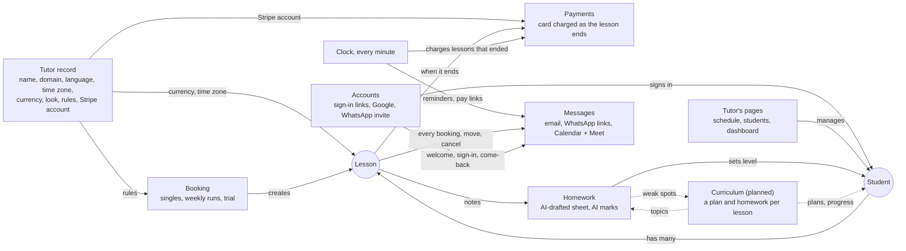
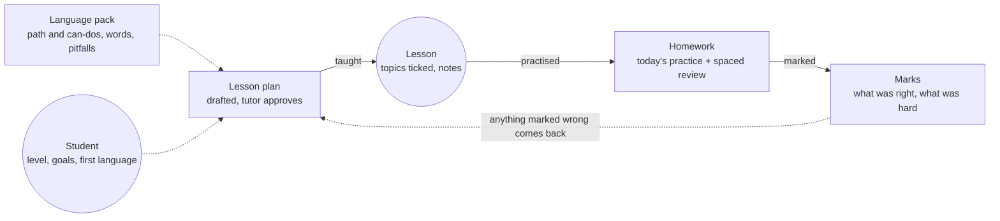

# How the tutor platform fits together

A map of how the platform's systems connect, and a review of whether they are simple, intuitive and flexible enough for each tutor to work their own way. Written 9 November 2026 for Dan, from the code on `main` at `2873b96` (booking Worker, D1 schema and site pages) and the plan "Turning the Inês site into a product for language tutors".

The illustrated version is the published [Tutor Platform Map](https://claude.ai/artifact/88kNajRKYQ7Kvm881KCy4F) (private to Dan's account). Its page source is [systems-map.html](./systems-map.html) in this folder. Where the two differ, the code and the published site win, as with the design system.

Expressions is left out on purpose. It is an add-on for Português com a Inês only, not part of the platform (Dan, 9 November 2026).

## Picking this up in a new session

- **What this is:** a review, not a spec. Nothing in it is built yet. The platform build's own notes live beside it in this folder (`HANDOFF.md`), and its steps are the ones named under "Passed to the platform build" below.
- **Before quoting a finding,** check whether the build has fixed it: search for the code named in the finding's "Where" column. Findings 1, 2 and 3 should land together, since all three change how a lesson keeps its terms.
- **Money and calendar rules still apply:** findings 1, 2, 5, 6 and 10 touch charging and change fees. Run `npm run test:booking` for any of them, and never change the manage-link tokens, iCalendar `UID`/`SEQUENCE` handling or same-day fee detection without it (AGENTS.md).
- **Decisions Dan has made:** Expressions stays out of the platform. The curriculum drafts a plan and homework for every lesson, built per language from research, and the tutor approves each one. Every rule in the tutor's interest becomes a setting that applies to new bookings only.
- **Still open, for Dan:** packages paid up front and paying before a first lesson (not in the plan), and whether WhatsApp messages for students without email should wait for the tutor to tap them or go through WhatsApp's business API.
- **Updating the map:** edit `systems-map.html` and republish it to the same artifact link, then keep this file in step.

## Verdict

- **Simple?** Yes, at the core. Every system hangs off two records, the student and the lesson. A weekly run is a real lesson row each week, so nothing special-cases it. Rules live in one settings table, money in one Stripe module, and timed work on one per-minute clock.
- **Intuitive?** For the tutor, mostly: one card and one next button per student, one dashboard per student. Payment states leak into the words she reads (finding 10). For students it is unproven: 3 of 21 had ever signed in on 2 November 2026.
- **Room to work their own way?** Not yet. Eight rules are written into the code instead of the tutor's settings, and students with no email never hear from the site. All of it is fixable, mostly in small steps.

## The map

Solid arrows happen today; dotted arrows are the planned curriculum.

Student and Lesson are the only records the other systems share. Booking, Payments and Homework each write to one of them and never to each other. The curriculum is the one deliberate exception: it and Homework form a loop, so what a student got wrong comes back in the next plan. Messages is the one outlet every system sends through.

## One lesson, start to finish

1. **Booked.** Booking checks hours, time off, buffer, notice and horizon, and prices the lesson at the student's own rate. Both get an email; the calendar gets an event, with a Meet link when online. (Findings 1, 5, 6, 7.)
2. **Ahead, planned.** The curriculum drafts a plan from the student's level, goals and what they got wrong last time. The tutor edits and approves it. (Finding 9.)
3. **24 hours before.** A reminder, timed to land before free changes end, by email only. (Findings 3, 4.)
4. **14 hours before.** Free changes end; a move or cancel now costs the late fee. (Finding 1.)
5. **Lesson ends.** The clock charges the saved card within a minute, unless the tutor ticked Already paid. A no-show is charged the late fee instead. (Findings 2, 10.)
6. **After.** Homework drafted from the notes plus review of earlier topics; the tutor publishes it, the student answers, AI marks it, the tutor returns it. (Finding 8.)
7. **Then, planned.** Topics are ticked off and anything marked wrong is scheduled to come back.

At any step the tutor can step outside the rules by hand: her own moves skip the student's notice rule, she can add a lesson outside her hours, tick Already paid or make a lesson free.

## The change that opens up most of the rules

A lesson stores only the name of the wording its student agreed to (`payment_consent_version`), and `changePolicy` reads the tutor's settings as they are now. Raising the notice from 14 to 24 hours would therefore apply to lessons already booked, so `/admin/settings` refuses more than 14 hours or €5.

Fix: copy notice, late fee and no-show rule onto each lesson and weekly run when it is booked, and have the change rule read the lesson's own terms. Settings changes then reach new bookings only, and the limits can open to 0 to 72 hours and up to the lesson price.

## Findings

Numbered as on the published map. 1 to 9 block something a tutor will reasonably want; 10 and 11 add complexity.

| # | Area | Today | Fix | Where |
|---|---|---|---|---|
| 1 | Booking | Notice capped at 14 hours and the late fee at €5, because lessons don't keep their own terms | Snapshot the terms onto each lesson and weekly run, then lift the caps | `policy.mjs` `changePolicy`; `index.mjs` `/admin/settings` ranges |
| 2 | Payments | A no-show is always charged the late fee, never the full lesson | Its own setting: full price, a fixed fee, or nothing | `index.mjs` `lessonChargePlan` |
| 3 | Messages | Reminders go out between the notice point and 24 hours before, so with notice of 24 hours or more no reminder is ever sent | Time the reminder from the tutor's notice, or give it its own setting | `index.mjs` `sendLessonReminders`, `REMINDER_LEAD_HOURS` |
| 4 | Messages | Every automatic message is email and the sender skips students with no address: 11 of Inês's 21 on 2 November get no confirmation, reminder or pay link | Choose the channel per student: email, otherwise a ready WhatsApp link in the tutor's Needs you | `email.mjs` (skips `no-email-yet`) |
| 5 | Student | A student's own price exists only for 60 and 90 minutes, and 90 is 1.5 times the hour unless set | Key a student's price by lesson type, any length | `schema.sql` `student_recurring_rates`; `rates.mjs` `withDerived` |
| 6 | Booking | Trial behaviour (one per student, no weekly repeat, own price) hangs on the id `trial`, checked in 11 places | Three switches per lesson type: first lesson only, can repeat weekly, student's own price applies | `index.mjs`; `rates.mjs` `lessonPriceSnapshotSql` |
| 7 | Lesson | A lesson's place must be `online` or `porto`, by a database rule | A list of places per tutor; needs a migration, not only a label | `schema.sql` `bookings.location`, `booking_series.location` |
| 8 | Homework | The AI writes European Portuguese only; levels fixed at A1 to C2 and length at 10, 15 or 20 minutes | Language and variant from the tutor record, levels from the curriculum, length a setting | `homework.mjs` draft instructions |
| 9 | Student | No level of its own; the dashboard reads the latest homework sheet's level | Store the level on the student, with the date it changed | `StudentDashboard.tsx`; `homework.mjs` `lastLevel` |
| 10 | Payments | Nine `payment_status` values, "paid by hand" stored in the consent column, and five more states for the late fee | Two plain questions per lesson: how it is paid, and where it is. Before many tutors, with `npm run test:booking` | `policy.mjs` `PAID_BY_HAND_MARK` |
| 11 | Platform | Picking the tutor from the web address misses three entry points with no address: the clock, Stripe's webhook and the Google Calendar return | The clock walks a list of tutors with work due; Stripe events name their account; the Google state names the tutor | `index.mjs` `scheduled()`, `/stripe/webhook`, `/google-calendar/callback` |

## The rules a tutor will want to set

| Rule | Inês today | Where it stands |
|---|---|---|
| Weekly hours and time off | Her schedule | Ready |
| How students pay | Card after the lesson, or by hand, both at once | Ready |
| Start times and gap after lessons | Every 15 minutes, 15 minutes free | In settings, no screen yet |
| How far ahead students book | 12 weeks | In settings, no screen yet |
| Lesson types and prices | Trial €20, 60 minutes €25, 90 minutes €35 | In data, no screen (6) |
| Booking notice | 14 hours | Capped at 14 hours (1) |
| Late change fee | €5 | Capped at €5 (1) |
| No-show | €5 instead of the lesson | Tied to the late fee (2) |
| Reminder | Before free changes end | Breaks at 24 hours' notice (3) |
| A student's own price | Per student | 60 and 90 minutes only (5) |
| Places | Online or Porto | Fixed in the database (7) |
| Currency and time zone | Euros, Lisbon time | Fixed in code; build step 1 |
| Homework language and levels | European Portuguese, A1 to C2 | Fixed in code (8) |
| How messages reach students | Email | Email only (4) |
| Email wording | Hers, in the templates | Fixed, except the come-back email |
| Packages paid up front, or paying before a first lesson | Not offered | Not built; not in the plan |

Packages of lessons and paying before a first lesson are common ways tutors work. Nobody needs them on day one, but a credit balance on the student that a lesson can draw from would leave room for both.

## Already simple, worth keeping

- Two records carry everything; weekly runs are real lesson rows.
- Rules sit in one settings table read by one loader, the shape of one tutor record.
- Money runs in one Stripe module on one clock, so connecting each tutor's own Stripe account is contained.
- The tutor can always step outside the rules by hand.
- Homework hangs off one lesson, one sheet each, and lesson notes stay private.
- Students without an email are still full students; only messages miss them (4).

## The curriculum: a plan and homework for every lesson

Dan, 9 November 2026: the curriculum should generate lesson plans for each student, with homework to match, based on the best research on how languages are learned, and specific to the language being taught.

Lesson, homework and marks exist today; the pack, the plan and the return loop are new. As with homework now, nothing reaches the student until the tutor has read and approved it.

| What works | Research | What the curriculum does |
|---|---|---|
| A balance of understanding, speaking or writing, studying the language, and fluency work | Nation, the four strands (2007) | Checks each week of lessons and homework gives each about a quarter of the time |
| Recalling from memory teaches more than rereading | Roediger and Karpicke, the testing effect (2006) | Homework asks students to produce answers |
| Review spread over days and weeks lasts longer | Cepeda and colleagues, spacing meta-analysis (2006) | Each sheet brings back earlier items at growing gaps, sooner for ones marked wrong |
| Lessons built around real tasks, grammar brought in as needed | Ellis, task-based teaching (2003); CEFR can-do descriptors (Council of Europe, 2020) | Each plan's goal is a can-do, such as "can arrange to meet a friend by phone" |
| Short, explicit teaching of a troublesome form helps | Norris and Ortega, meta-analysis (2000) | A brief, direct explanation of the form the student keeps getting wrong, then practice in use |
| The most frequent words give the biggest return | Nation, Learning Vocabulary in Another Language (2013) | New words from the language's frequency bands, plus the student's own goal words |
| Prompting learners to correct themselves leads to more repair | Lyster and Ranta, corrective feedback (1997) | Marks group errors into patterns so the tutor knows what to prompt for |

**Built for each language.** A language pack sets:

- the path, from the language's own guide to the CEFR levels: the Referencial Camões and CAPLE exams for Portuguese, the Instituto Cervantes Plan curricular and DELE for Spanish, DELF for French, Profile Deutsch and Goethe for German; other scales such as HSK and JLPT where the CEFR isn't used;
- the variant, chosen by the tutor: European or Brazilian Portuguese, Spain or Latin American Spanish;
- words from frequency lists for that language;
- trouble spots by the student's first language: an English speaker learning Portuguese needs ser and estar, nasal vowels and false friends like puxar (pull); a Spanish speaker needs pronunciation and false friends instead;
- pace by language: the US Foreign Service Institute puts Portuguese or Spanish at about 24 to 30 weeks of full-time study for an English speaker, Japanese or Mandarin at about 88.

AI drafts each pack once per language and variant from those references, and a native-speaker teacher checks it before any tutor gets it; Inês would check the European Portuguese one first. Each tutor can edit their copy, add their own materials, or switch the curriculum off.

**Data it needs:** the language pack; the student's level, goals and first language; a plan on each lesson and the topics it covered; and a review list fed by the marks. Inês's free-text plan for each student (`students.lesson_plan`) becomes their goals.

The research backs these principles across languages but doesn't crown one method, and most of it comes from classrooms rather than one-to-one lessons. That is another reason the tutor approves every plan.

## Passed to the platform build

Sent to the thread building the platform, matched to its steps:

- **Step 1, tutor record:** language and variant, places, reminder timing and the no-show rule, alongside name, domain, currency and time zone (2, 3, 7, 8).
- **Step 2, tutor from the address:** cover the clock, Stripe's webhook and the Google Calendar return (11).
- **Before tutors set their own rules:** snapshot terms on each lesson and weekly run, then lift the caps (1); trial as lesson-type switches and a student's price per lesson type (5, 6).
- **Messages:** a channel per student (4).
- **Before many tutors:** simplify the payment states (10).
- **Step 7, curriculum:** a plan and homework per lesson from a checked language pack, with a review list fed by the marks; reserve the student's level, goals and first language now (9).
